<div align="center">

<a href="https://equin.ai">

</a>

<p>
<a href="https://equin.ai"><b>equin.ai</b></a> &nbsp;·&nbsp;
<a href="https://equin.ai/">▶ Watch the film</a> &nbsp;·&nbsp;
<a href="https://equin.ai/vision">Vision</a> &nbsp;·&nbsp;
<a href="https://equin.ai/apps">Apps</a> &nbsp;·&nbsp;
<a href="#-install">Install</a>
</p>

<a href="https://equin.ai/apps">

</a>

</div>

## ✦ What is equin?

equin is an agentic platform for building large apps at scale: hundreds of features,
maintained autonomously, built to last for years.
It adds [hundreds of improvements](https://equin.ai/foundations) on top of raw Claude:

- an **agent manager** designed to monitor dozens of sessions in parallel
- **background agents** that fix, push and update the app on their own
- a **plugin system** where every feature is a self-contained block that every app can reuse

## ◎ What people build with it

<table>
<tr>
<td width="50%" valign="top">

### Apps for a team or an organization

Production-grade apps that can be deployed standalone. Use the platform to develop the app from within. equin provides the harness, agent-friendly primitives, an automated reporting system for bugs and performance issues, and [much more](https://equin.ai/foundations).

</td>
<td width="50%" valign="top">

### A personal operating system

The author's showcase: custom versions of every app they use daily, connected
to each other in one app:

* A custom agent manager
* A custom Notion
* A custom design tool
* A custom map app
* A custom piano learning app
* A custom file explorer
* ...

</td>
</tr>
</table>

## ▶ Try it

<a href="https://equin.ai/demo">

</a>

## ⚡ Install

```bash
curl -fsSL https://raw.githubusercontent.com/equinai/equin/main/install.sh | bash
```

Or prompt your agent:

```
Install equin (https://github.com/equinai/equin) on this Mac with its installer:
curl -fsSL https://raw.githubusercontent.com/equinai/equin/main/install.sh | bash
If a step fails, fix it and run the installer again. When it is done, give me the link to the app.
```

Then open the address the installer prints — `http://equin.localhost:<port>`, where the port is 8700 unless something else holds it (then the next free one up to 8709); `./equin url` prints it again. And start your first wish.
