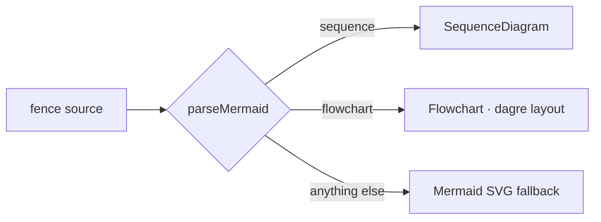

# Code preview v2: native drawing for Mermaid sequence + flowchart

## Context

v1 drew every ```` ```mermaid ```` fence through Mermaid's own SVG. In a
conversation those diagrams looked dated and were drawn too small to read. The
prototype `proto-1792499588-rr4kzl` showed the direction: participant and node
cards, coloured numbered steps, label pills, at the conversation's own text size,
scrolling sideways instead of shrinking.

## Design

Mermaid *syntax* stays the input, since models write it fluently. Only the
drawing changes.



Everything stays inside `code-preview/plugins/mermaid`, still the one
`CodePreview.Renderer` for `mermaid`. The registry and its consumers are
unchanged.

- `core/` holds `parseMermaid(source)` and the diagram models.
  - It returns `{ kind: "sequence" | "flowchart", diagram }`, or
    `{ kind: "unsupported", reason }`.
  - It is pure and tested.
  - The supported subset:
    - **sequence:** participant/actor (`as` alias), every arrow form,
      notes over / left of / right of, loop/alt/else/opt/par/and/critical/break/rect
      blocks, autonumber, activate.
    - **flowchart:** TB/TD/BT/LR/RL, every node shape, solid / dotted / thick
      links with `|label|` or inline text, `&` fan-out and chains, subgraphs, and
      styling statements, which are ignored.
  - Anything it does not model (or a line it cannot read) is `unsupported`, so
    Mermaid draws it. Mermaid stays the authority on syntax errors.
- `web/` holds three renderers:
  - **`SequenceDiagram`:** a CSS grid with one column per participant and
    `subgrid` frames for blocks. Lifelines run behind. Each participant gets a
    hue mixed toward `--foreground`, so it is theme-aware.
  - **`Flowchart`:** nodes rendered as HTML and measured, then laid out with
    `dagre` (already the repo's layout lib, via `graph-canvas`). Edges are drawn as
    smoothed SVG through dagre's points, with label pills and subgraph boxes.
    It is lazy-loaded.
  - **The v1 Mermaid SVG renderer**, used as the fallback.
- Every renderer is drawn at natural size, inside a horizontal `Scroll`.

## Verification

- Unit tests for the parser (`./singularity test …/mermaid`).
- `./singularity build`, then look at the two prototype diagrams, plus a block, a
  subgraph and an unsupported type (gantt), in a page split view and the file
  viewer. Check both light and dark.
