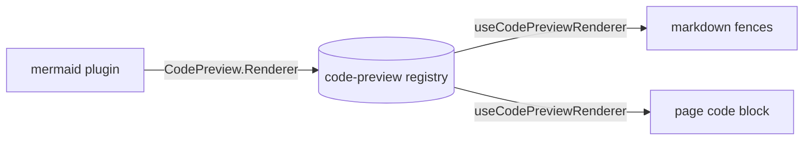

# Code preview: render fenced code by language (Mermaid first)

## Context

Agents explain flows with hand-drawn ASCII diagrams because nothing renders a
diagram language. Mermaid is the language LLMs emit by default (sequence,
flowchart, state, ER, gantt…). We want a ```` ```mermaid ```` fence to render as a
diagram both in conversation markdown and in the page editor's code block
(Notion-style Code / Preview / Split), with other languages (DOT, Vega-Lite)
addable later with zero consumer changes.

## Design



### 1. Registry — `primitives/syntax-highlight/plugins/code-preview` (new)

Sibling of `overlay-textarea`; code presentation already lives under
`syntax-highlight`.

- Slot `CodePreview.Renderer` (`defineSlot`):
  `{ lang: string; aliases?: string[]; label: string; Component: ComponentType<{ source: string }> }`.
- `useCodePreviewRenderer(lang | null | undefined)` → the matching contribution
  (lang or alias, case-insensitive) or `null`.
- `useCodePreviewLangs()` → `{ lang, label }[]` for pickers.
- `<CodePreviewError message source? />` — shared loud error chrome
  (destructive caption + the source) every renderer uses.

Consumers (markdown, page code-block) only use these generic hooks; they never
name Mermaid.

### 2. Mermaid contributor — `code-preview/plugins/mermaid` (new)

- Own `package.json` dependency on `mermaid` (^11).
- `MermaidPreview` = `lazyComponent(() => import("./mermaid-preview-impl"))`
  (mermaid is ~MBs; keep it out of boot, like `math/render`'s KaTeX).
- Impl: renders are serialized through one promise chain (mermaid config is
  global). Each render: `mermaid.initialize({ startOnLoad:false,
  securityLevel:"strict", theme:"base", themeVariables })`, `mermaid.parse`, then
  `mermaid.render(id, source)`; the SVG is injected.
- Theme: `themeVariables` built from the container's resolved CSS tokens
  (`--background`, `--foreground`, `--muted`, `--border`, `--muted-foreground`,
  `--accent`, `--card`, font family). Tokens may be `oklch()`, which mermaid's
  colour math can't parse, so each is normalised to `#rrggbb` through a 1×1
  canvas. Re-render on `useDarkMode()` flips.
- Errors: parse/render failures show `<CodePreviewError>`. While editing, the
  last good SVG stays visible above the error, so a half-typed edge doesn't
  blank the diagram. The error still shows.
- Contributes `CodePreview.Renderer({ lang: "mermaid", aliases: ["mmd"], label: "Mermaid", Component: MermaidPreview })`.

### 3. Markdown — `primitives/markdown`

`base-components.tsx` `code`: the block branch renders a new `FencedCode`
component. It calls `useCodePreviewRenderer(lang)`. With a renderer, it shows the
preview with a hover toolbar (Preview/Code toggle via `ViewSwitcher`, copy).
Otherwise it shows `HighlightedCode` exactly as today. Conversation assistant
text, outcome reports and file-viewer markdown all get it for free.

### 4. Page code block — `page/code-block`

- Schema: `view: z.enum(["code","preview","split"]).optional()`. It is display
  state, so it is not serialized to markdown; the fence round-trip is unchanged.
- `renderer = useCodePreviewRenderer(language)` (explicit language only, never
  auto-detected).
- With a renderer, the toolbar gains a Code / Preview / Split `ViewSwitcher`;
  the default is `split`.
  - `code` is today's editor.
  - `preview` shows only the diagram, and a click switches to split and focuses.
  - `split` shows the editor above the preview.
- `view` is carried through `rowData` and `onLanguageChange` via a latest-ref,
  the same way as `language`.
- The language picker lists `SHIKI_LANGS` ∪ the registry's languages.

### 5. `/mermaid` — `page/code-block/plugins/mermaid-insert` (new)

An `Editor.InsertAction` "Mermaid diagram" (`after: "code-block"`, aliases
diagram/flowchart/sequence). It does `editor.convertTo("code-block", { code: "",
language: "mermaid", view: "split" })`. It is a contributor, so naming mermaid is
fine.

## Files

- New: `plugins/primitives/plugins/syntax-highlight/plugins/code-preview/{web/index.ts, web/internal/*, package.json}`
- New: `.../code-preview/plugins/mermaid/{web/index.ts, web/internal/mermaid-preview{,-impl}.tsx, web/internal/theme-vars.ts, package.json}`
- Edit: `plugins/primitives/plugins/markdown/web/internal/base-components.tsx` (+ new `fenced-code.tsx`)
- Edit: `plugins/page/plugins/code-block/core/code-block.ts`, `web/components/code-block.tsx`
- New: `plugins/page/plugins/code-block/plugins/mermaid-insert/web/index.ts`

## Verification

- `./singularity build` (installs mermaid, regenerates registries/docs, runs checks).
- Browser MCP: a conversation/markdown containing a mermaid fence renders an SVG.
  A page code block with language mermaid shows Code/Preview/Split, and
  `/mermaid` inserts one. Check dark mode, and an invalid source shows the error.
- Push with `./singularity push` (user-authorized).
